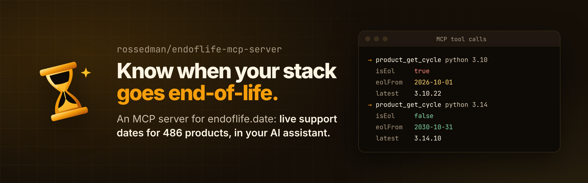

<p align="center">
  
</p>

<p align="center">
  <a href="https://github.com/rossedman/endoflife-mcp-server/actions/workflows/ci.yml"></a>
  <a href="https://pypi.org/project/endoflife-mcp-server/"></a>
  <a href="https://pypi.org/project/endoflife-mcp-server/"></a>
  <a href="https://rossedman.io/endoflife-mcp-server/"></a>
  <a href="LICENSE"></a>
  <a href="https://github.com/astral-sh/ruff"></a>
  <a href="https://github.com/astral-sh/uv"></a>
</p>

An [MCP](https://modelcontextprotocol.io/) server for [endoflife.date](https://endoflife.date/). It lets Claude, or any other MCP client, answer questions like "is Kubernetes 1.31 still supported?" or "which Postgres versions get updates past next summer?" from live data on about 500 products, instead of from whatever the model remembers.

## Install

The server is a Python package. With [uv](https://docs.astral.sh/uv/), you don't need to install anything first:

```sh
uvx endoflife-mcp-server serve
```

Or install it as a tool, with uv or pipx:

```sh
uv tool install endoflife-mcp-server
pipx install endoflife-mcp-server
```

It needs Python 3.11 or newer; `uvx` downloads one if you don't have it.

## Quick start

Add it to Claude Code:

```sh
claude mcp add -s user endoflife -- uvx endoflife-mcp-server serve
```

Then ask:

> We upgrade every six months. Which etcd versions will still be supported when we next upgrade?

For Claude Desktop and other clients that use a JSON config, add:

```json
{
  "mcpServers": {
    "endoflife": {
      "command": "uvx",
      "args": ["endoflife-mcp-server", "serve"]
    }
  }
}
```

To serve over HTTP instead of stdio, run `endoflife-mcp-server serve --transport streamable-http` and point your client at `http://127.0.0.1:8000/mcp`.

## Tools

| Tool | What it returns |
| --- | --- |
| `product_list_all` | The name of every product endoflife.date tracks |
| `product_get_all` | A product with all of its release cycles and their dates |
| `product_get_cycle` | One release cycle, such as `python` `3.12` |
| `product_get_latest` | The newest release cycle of a product |
| `category_list`, `category_list_products` | Categories (`lang`, `os`, `database`, ...) and the products in each |
| `tag_list`, `tag_list_products` | Tags (`linux-distribution`, `amazon`, `cncf`, ...) and the products with each |

Every tool is read-only. Aliases work (`k8s` is `kubernetes`), and an unknown name comes back as an error that suggests close matches (`pyhton` suggests `python`), so the model can correct itself. The [tools reference](https://rossedman.io/endoflife-mcp-server/reference/tools/) has every parameter.

## Configuration

Settings come from, highest precedence first: `serve` options, then `ENDOFLIFE_MCP_*` environment variables, then a TOML config file, then the defaults.

| Setting | Option | Environment variable | Default |
| --- | --- | --- | --- |
| `transport` | `--transport` | `ENDOFLIFE_MCP_TRANSPORT` | `stdio` (or `streamable-http`) |
| `host` | `--host` | `ENDOFLIFE_MCP_HOST` | `127.0.0.1` |
| `port` | `--port` | `ENDOFLIFE_MCP_PORT` | `8000` |
| `api_url` | `--api-url` | `ENDOFLIFE_MCP_API_URL` | `https://endoflife.date/api/v1` |
| `timeout` | `--timeout` | `ENDOFLIFE_MCP_TIMEOUT` | `10` seconds |
| `log_level` | | `ENDOFLIFE_MCP_LOG_LEVEL` | `WARNING` (logs go to stderr) |

The config file is `$XDG_CONFIG_HOME/endoflife-mcp-server/config.toml` (usually `~/.config/endoflife-mcp-server/config.toml`), or the file passed with `endoflife-mcp-server --config <file> serve`:

```toml
timeout = 5
log_level = "INFO"
```

See [Configuration](https://rossedman.io/endoflife-mcp-server/configuration/) in the docs for details.

## Docs

Full documentation is at **<https://rossedman.io/endoflife-mcp-server/>**: getting started, every tool, configuration, and the CLI and API reference.

## Contributing

Contributions are welcome. [CONTRIBUTING.md](CONTRIBUTING.md) covers setup (`uv sync --all-groups`), the one command that runs every check (`make check`), and the quality bars. Report security problems privately, as described in [SECURITY.md](SECURITY.md).

The end-of-life data comes from [endoflife.date](https://endoflife.date/), a community project. If a date is wrong, [fix it there](https://github.com/endoflife-date/endoflife.date), and every user of this server gets the fix.

## License

[MIT](LICENSE)
